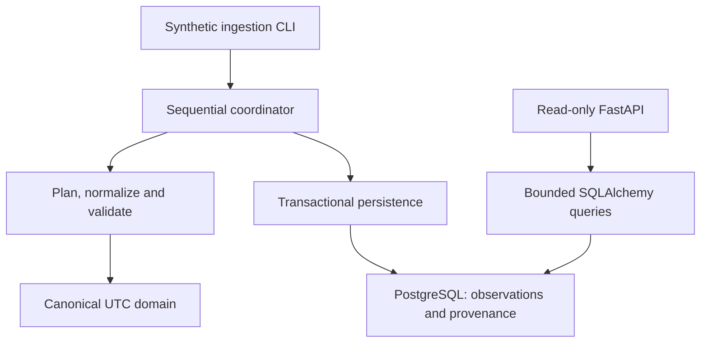

# Hellas DataOps

A Python data engineering and backend portfolio: validate hourly weather,
persist it reliably in PostgreSQL, and query it through a read-only FastAPI API.
The project demonstrates explicit data contracts, idempotent transactional
writes, durable progress and deliberate resume after failure.

**Status:** the accepted synthetic end-to-end MVP is publicly available on
[GitHub](https://github.com/GiannisPap24/hellas-dataops) under the MIT licence.
The demonstration runs the actual ingestion CLI, PostgreSQL, Uvicorn and HTTP API. Open-Meteo
request planning, transport and normalization are implemented and tested with
synthetic responses; **live weather ingestion has not been verified or enabled
in the operational CLI**. This is not a publicly deployed service.

## What it demonstrates

- UTC hourly contracts, finite numeric validation and nullable measurements.
- Bounded request chunks, full-response validation and precise retained hours.
- Atomic chunk writes, identical replay without duplicates, explicit corrections
  with previous values and lineage retained in provenance.
- Persisted run/chunk progress, sequential processing and explicit resume.
- Parameterized, read-only SQL queries with keyset pagination and bounded results.
- Deterministic offline tests plus isolated real PostgreSQL and HTTP verification.

**Stack:** Python 3.14.4, PostgreSQL 18.6, SQLAlchemy Core 2.1.6, Alembic 1.20.0,
pg8000 1.31.5, FastAPI 0.159.1, Pydantic, Uvicorn, pytest, Ruff, uv and Docker
Compose. SQLAlchemy uses its supported pure-Python build on Windows.

## Architecture

A synchronous modular monolith; no scheduler, queue or microservices.



Source retrieval occurs outside database transactions. Each chunk commits its
observations and success receipt together; a partially completed run is not
whole-run success. The domain stays independent of FastAPI and database code.
See [architecture](docs/architecture.md), [data contracts](docs/data-contract.md),
[persistence](docs/persistence.md) and [resume semantics](docs/ingestion.md).

## Set up and run

Verified platform: **Windows x64 / CPython 3.14.4**. Start with the
[Windows setup guide](docs/setup.md): it bootstraps uv 0.13.4 locally and installs
`uv.lock` into `.venv`, without global package or security-policy changes.
A full-history checkout on `main` is required for guarded host workflows.

After setup, from the project root in ordinary PowerShell:

```powershell
$env:PYTEST_DISABLE_PLUGIN_AUTOLOAD = '1'
& .\.venv\Scripts\python.exe -I -B -m pytest -q -p no:cacheprovider
& .\.venv\Scripts\python.exe -I -B -m ruff check .
& .\.venv\Scripts\python.exe -I -B -m ruff format --check .
```

With Docker Desktop's Linux Engine running, execute the full demonstration:

```powershell
& .\scripts\demo.ps1
```

It creates a fresh, uniquely owned localhost PostgreSQL environment, migrates it,
ingests **168 synthetic Athens hours for January 1-8, 2025 (exclusive end)**,
checks unchanged replay and resume, starts real Uvicorn, verifies HTTP responses,
and records a bounded benchmark. The API child stops; Docker resources remain
for inspection. Nothing contacts a weather API or deletes existing volumes.

The [demo runbook](docs/demo.md) explains reports and starting the API afterwards
against that exact retained configuration. Visit `http://127.0.0.1:8000/docs`
for Swagger or `/openapi.json` for its JSON schema. [VS Code](docs/vscode.md)
provides explicit offline-test, PostgreSQL-test, demo and debugger tasks.

## API

| GET endpoint | Purpose |
| --- | --- |
| `/health/live` | Process liveness; no database access |
| `/health/ready` | Database connectivity and expected schema availability |
| `/v1/cities` | Supported registry and separately persisted coordinate versions |
| `/v1/weather` | Stored hourly observations, units and dataset identity |

Example, once the local API is running against the demo database:

```powershell
Invoke-RestMethod 'http://127.0.0.1:8000/v1/weather?city_id=athens&coordinate_version=gr-cities-v1&provider_id=open-meteo&dataset_id=era5_hourly-v1&start=2025-01-01T00:00:00Z&end=2025-01-08T00:00:00Z&limit=100'
```

Queries require city, coordinate version, provider, dataset and a UTC hourly
`[start,end)` interval, at most 31 days. Pages default to 100 and are capped at
500; pass `next_after` as `after`. Null measurements remain JSON null. Invalid
inputs return 422, missing identities 404, unavailable storage 503. Pages do not
share a cross-request snapshot. See [the API contract](docs/api.md).

## Verification evidence

The final audit passed **974 offline tests**. Previously accepted host evidence
includes **133 real PostgreSQL tests** and a fresh synthetic end-to-end run. Final audit results and their
scope are recorded in [release readiness](docs/release-readiness.md).

The accepted Windows host demo recorded these local results on 168 stored rows:

| Returned rows | p50 | p95 | Response bytes | Errors |
| --- | ---: | ---: | ---: | ---: |
| 100 | 49.42 ms | 63.63 ms | 14,078 | 0 |
| 168 | 59.62 ms | 62.95 ms | 23,308 | 0 |

Each query used five warm-ups, 30 measured requests and concurrency one.
These include HTTP and database connection overhead; they are **not production
capacity claims**. [Demo evidence and methodology](docs/demo.md#final-acceptance-fresh-host-demonstration).
Default tests block network access. Real database tests are separate:
`& .\scripts\verify-postgres.ps1`. [Build and installation checks](docs/setup.md#build-and-verify-distributions).

## Boundaries and release status

- Synthetic data is invented: 10 C temperature with intentional null humidity,
  precipitation and wind. The ERA5 identity does not prove a live provider response.
- Real five-city/year-2025 backfills remain gated on service terms and explicit
  authorization. Reanalysis is not station data.
- No authentication, public hosting, production database role, automatic retries,
  scheduling or whole-request deadline. Only a guarded local disposable database
  is supported. Chunk atomicity is not whole-run atomicity or proven crash recovery.
- Windows setup is verified locally; other platforms and graphical debugger
  interaction are unverified. Swagger's interactive assets use an external CDN.

## Licence

Code and project documentation are licensed under [MIT](LICENSE).
Copyright (c) 2026 GiannisPap24. Third-party dependencies retain their own
licences. The code licence does not grant access to Open-Meteo services or
relicense provider data; see [attribution and service restrictions](docs/licensing.md).

Public GitHub publication was completed on 2026-10-24; see the
[publication record](docs/publication.md) for the initial commit and verification.
Hosted deployment and live weather ingestion remain outside the accepted scope.
Engineering rules: [AGENTS.md](AGENTS.md).
